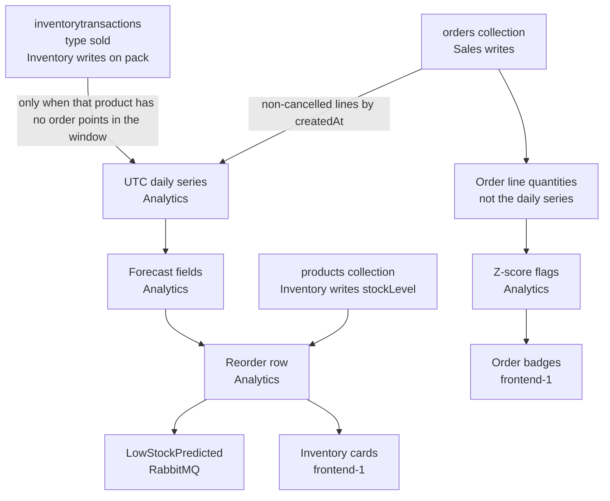

# Analytics data lineage and consistency boundaries

How operational records become a daily demand series, a forecast, a reorder suggestion, an advisory event, and a UI card.

Analytics (port 3006) is a separate process. It reads one shared MongoDB database, default name `smartchain`, through the same `MONGO_URI` as IAM, Sales, Inventory, Warehouse, and Logistics. This is an MVP service architecture with shared storage, not a strict database-per-service split. Analytics does not insert, update, or delete documents. Inventory and Sales remain the writers.

Method formulas live in [analytics-technical-note.md](./analytics-technical-note.md). Order events live in [order-lifecycle.md](./order-lifecycle.md).

## Path

The inventory dashboard does not call `GET /forecast/:productId`. `ForecastSummaryCard` and `ReorderSuggestionsCard` both call `GET /reorder` and read the forecast fields on each suggestion row. `GET /demand/:productId` and `GET /forecast/:productId` are direct API reads of the same aggregation and forecast functions. Order list, order detail, and system reports call `GET /anomalies`.

## Collection ownership

| Collection | Writer | Analytics use |
|---|---|---|
| `orders` | Sales | Read. Demand sums line quantities. Anomalies score line quantities. |
| `products` | Inventory | Read. Active products supply `sku`, `name`, `stockLevel`, `reorderPoint`. |
| `inventorytransactions` | Inventory | Read, and only rows with `type: "sold"`, and only as the demand fallback below. |
| `reservations` | Inventory | Not read. Stock changes on reserve are visible only through `products.stockLevel`. |
| Warehouse, logistics, and IAM collections | Those services | Same database. Not inputs to these transforms. |

Analytics keeps its own Mongoose copies of the Sales order schema and the Inventory product and inventory-transaction schemas (`microservices/analytics/models/`). The copies name the same collections (`orders`, `products`, `inventorytransactions`). The owner models rely on Mongoose plural names and resolve to those same collections. The copies are not imported from Sales or Inventory, so a later field change on the writer is not enforced on the reader.

Indexes that exist today come from the schemas: unique `orders.orderNumber` and unique `products.sku`. There is no compound index for the demand queries (`orders` by `items.productId` and `createdAt`, or `inventorytransactions` by `productId`, `type`, and `createdAt`).

## Transformations

| Step | Input | Output | Owner | Validation |
|---|---|---|---|---|
| Order lines to sparse days | Non-cancelled `orders` whose `items.productId` matches. Quantity is `items.quantity`. The day is `createdAt`. | `{ date: YYYY-MM-DD, quantity }` summed per day. A multi-product call also returns `productId`. | Sales writes the order. `demandAggregationService` aggregates it. | `productId` must be an ObjectId. An invalid `from` or `to` throws. Status `cancelled` is excluded. After `$unwind`, lines for other products are dropped. |
| Sparse days to a calendar series | Sparse points, plus optional `from` and `to`. | One `{ date, quantity }` per UTC day from the first day through the last. Missing days are `0`. | `fillMissingDemandDays` in Analytics. | A point with no date throws. A non-finite or negative quantity throws. `from` after `to` throws. An empty input stays `[]` and is not padded. |
| Sold fallback | `inventorytransactions` with `type: "sold"` for products that had **no** order points in the window. Quantity is the absolute value. | Same calendar series shape. | Inventory writes a `sold` row when it handles `warehouse.order.packed`. Analytics reads it. | Same date and quantity checks as the order path. `reserved`, `released`, `received`, `adjusted`, and `returned` are never demand. |
| Series to forecast | The calendar series for one product. | `forecastMethod`, `averageDailyDemand`, `predictedDemand`, `pointsUsed`, holdout `evaluation`, residual `uncertainty`, and `explanation`. | `forecastService.selectForecastMethod`. | `GET /forecast/:productId` returns `forecastMethod: null` and `predictedDemand: 0` when the series is empty, and does not run method selection. `GET /reorder` still calls selection on an empty series, which takes the moving-average branch and also returns predicted demand `0`. |
| Stock plus forecast to a reorder row | Active `products` (`stockLevel`, `reorderPoint`, `sku`, `name`) and that product's forecast. | `suggestedQuantity = max(0, ceil(predictedDemand) + reorderPoint - stockLevel)`, plus `shouldReorder`, `targetStock`, and `reason`. | Inventory writes the product. `reorderSuggestionService` computes the row. | Non-finite or negative stock, reorder point, or predicted demand is treated as `0`. Predicted demand is ceiled before the subtraction. |
| Reorder row to an event | A suggestion row from the scheduled evaluation. | `LowStockPredicted` on `analytics.low_stock.predicted` when ceiled `predictedDemand > stockLevel`, unless the stored signal for that product and horizon already matches. | `lowStockSchedule` writes `lowstocksignals` and an outbox row in one transaction. | `GET /reorder` does not publish. Non-finite stock or demand does not emit. An unchanged evaluation inside the cooldown does not emit again. |
| Reorder payload to inventory cards | `GET /reorder` JSON. | Forecast card: products with `predictedDemand > 0`, rounded total, top three products, method names. Reorder card: the suggestion rows. | `frontend-1` `ForecastSummaryCard` and `ReorderSuggestionsCard`. Display helpers only format text. | A failed request shows the API error. An empty product list shows the empty state. The UI does not recompute the forecast. |
| Order lines to anomaly flags | Non-cancelled `orders`, newest first. History for a line is the quantities of that `productId` on the **other** loaded orders. | Flagged lines with `zScore`, `severity`, and `reason`, grouped by order. Default threshold `2.5`, default limit 50. | Sales writes the orders. `anomalyService` scores them. | Fewer than 3 prior quantities is not a flag. Sample standard deviation is used. The daily series is not an input. |

`GET /demand/:productId` returns `{ productId, data }` and does not say whether `data` came from orders or from `sold`.

## Fallback and double-counting

Demand for a product comes from one source inside a query window.

- If the order aggregation returns at least one day, that product uses orders only. `sold` rows for the same product are not added.
- If the order aggregation returns nothing, the product uses `sold` only.
- The two sources are never summed. A batch request applies this choice per product, then gap-fills each product on its own.
- `reserved` is not demand. A reservation is later followed by a `sold` row on pack, and counting both would count the same units twice. `sold` quantities are stored as positive line quantities; the aggregation still takes the absolute value.
- Cancelled orders are omitted. Pending, confirmed, packed, shipping, and delivered orders all count, on the order's `createdAt` day, not on a ship date.

Order demand and `sold` demand are different quantities. Order demand is units placed, including orders that are still pending. `sold` demand is units recorded when a reserved order is packed. The fallback is used only when the order query is empty, so a product is not silently switched day by day.

Day keys are UTC. `$dateToString` on `createdAt` uses UTC. Gap filling uses UTC midnight. A date-only `to` includes that whole UTC day (`createdAt < next midnight`). A full timestamp `to` is inclusive (`createdAt <=` that instant). `GET /anomalies` does not use those bounds: `from` and `to` are passed to `new Date` and compared directly.

## Consistency limitations

- `products.stockLevel` is the number Inventory last saved. Reservation decrements it when stock is reserved. The `sold` transaction is written later, on pack, and does not decrement stock again. Analytics does not rebuild stock from `inventorytransactions`, and it does not join `orderId` to prove that an order line and a `sold` row are the same units.
- A missed `sales.order.created` or `warehouse.order.packed` handler leaves `stockLevel`, reservations, and `sold` rows out of step. The forecast still reads whatever documents are present.
- Because any in-window order suppresses the fallback, fulfilled `sold` rows are ignored for that product even when some units never appear on an order line in the window.
- Because an empty order window selects the fallback, a product with only older orders can be forecast from pack-time `sold` rows, which use a different clock than `orders.createdAt`.
- Anomaly history is the set of loaded order lines, not the zero-filled daily series. A quiet calendar day does not change the z-score. The anomaly query also loads every matching order into memory before it stops at `limit`.
- `GET /reorder` does not publish. The scheduled evaluation stores the last low-stock signal for each product and horizon. An unchanged forecast inside the cooldown does not write another event.
- Copied schemas can drift from the writer schemas. MongoDB does not enforce the cross-service references (`productId`, `orderId`, `customerId`).

## Not implemented

These are not in the repository:

- A compound index on `orders` for `items.productId` and `createdAt`.
- A compound index on `inventorytransactions` for `productId`, `type`, and `createdAt`.
- One shared schema module, or an Analytics-owned daily demand collection, so the reader does not depend on a copied writer schema.
- A `source` field on the demand and forecast responses (`orders` or `inventory_sold`).
