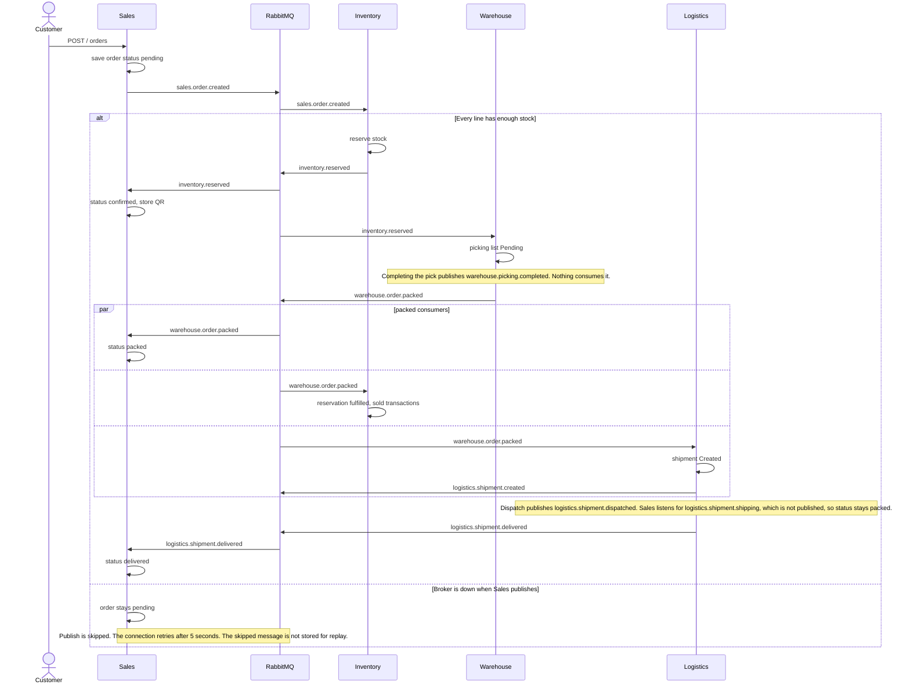

# Order lifecycle and event contracts

How an order moves from Sales through Inventory, Warehouse, and Logistics, and which RabbitMQ messages exist today.

Exchange: topic exchange `smartchain_exchange` (`RABBITMQ_EXCHANGE`). Each service uses a durable queue named `{RABBITMQ_QUEUE_PREFIX}{service}_events`. The prefix defaults to `smart-chain-`.

Payloads are the `payload` object inside a version 1 event envelope. The envelope fields are `eventId`, `eventType`, `eventVersion`, `occurredAt`, `producer`, `correlationId`, `causationId`, and `payload`. `eventType` is the routing key. `eventVersion` is `1`. `correlationId` is the order id when the payload has `orderId`, otherwise the product id, otherwise `eventId`. `causationId` is the `eventId` of the message being handled, or `null` when the publish comes from an HTTP request.

`LowStockPredicted` is not part of this order flow. It is documented at the end.

## Success path

A second stop, inside the consumer rather than at publish time: if any line has insufficient stock, Inventory logs the shortage and returns. It does not publish `inventory.reserved`. The `sales.order.created` delivery is still acknowledged, because the handler does not throw, and the event id is stored. A redelivery does not try the reservation again. The order remains `pending`.

Order status values in Sales are `pending`, `confirmed`, `packed`, `shipping`, `delivered`, and `cancelled`. The event path above sets `confirmed`, `packed`, and `delivered`. `shipping` is set only by a handler for `logistics.shipment.shipping`. No publisher uses that routing key. `PUT` order status can change the status in MongoDB without publishing an event.

## Acknowledgement, retry, and dead letter

All five consumers use manual acknowledgement (`noAck: false`). Inventory, Warehouse, Logistics, Analytics, and Sales each declare three delay queues and one dead-letter queue beside the main queue.

| Queue | Role |
|---|---|
| `{prefix}{service}_events` | Main consumer queue |
| `{prefix}{service}_events.retry.1` | First retry. Message TTL is 1 second, then the message returns to `smartchain_exchange` with its original routing key |
| `{prefix}{service}_events.retry.2` | Second retry. TTL is 5 seconds |
| `{prefix}{service}_events.retry.3` | Third retry. TTL is 15 seconds |
| `{prefix}{service}_events.dlq` | Dead-letter queue. Nothing consumes it |

`EVENT_RETRY_DELAYS_MS` can replace the three delays with a comma-separated list of millisecond values. Changing it after the retry queues already exist requires deleting those queues, because RabbitMQ keeps the TTL that was declared first.

| Outcome | What the consumer does |
|---|---|
| Handler finishes, including a duplicate `eventId` or a business return such as insufficient stock | `ack` |
| Handler throws a retryable error and `x-retry-count` is below the delay count | publish the same body to the next retry exchange with `x-retry-count` increased by 1, then `ack` |
| Handler throws `PermanentError`, a Mongoose `ValidationError` or `CastError`, the retry count is exhausted, the body is not JSON, the version is not 1, `eventType` does not match the routing key, or the payload fails validation | publish the same body once to that service's dead-letter queue, then `ack` |
| Routing key has no handler on that queue | log, then `ack` |
| The retry or dead-letter publish itself fails | `nack(msg, false, true)` so the original message stays on the main queue |

A retryable error is any other thrown error, including a database timeout while the handler is writing. The handler is not acknowledged when it throws. The delay queues perform the wait. A permanent failure is not put on a delay queue.

`publishEvent` validates the payload, wraps it in a version 1 envelope, and inserts that envelope into the `outboxevents` collection in the caller's MongoDB session. It does not talk to RabbitMQ. The service publisher later sends the stored envelope.

## Transactional outbox

A domain write and its event are stored in one MongoDB transaction. The background publisher in that service claims pending rows for its own producer, sends the stored envelope on a confirm channel, and marks the row published only after the broker confirms. The message properties still include `messageId` (`eventId`) and `correlationId`.

If the broker is down or rejects the publish, the row stays `pending` and a later pass sends the same `eventId`. A restart reads the same collection, so the domain write is not repeated and the event is not dropped. Two publishers cannot hold a fresh claim on the same row. A claim older than `EVENT_OUTBOX_CLAIM_MS` (default 30 seconds) can be taken again. After a successful publish, `expiresAt` is set to seven days unless `EVENT_OUTBOX_RETENTION_DAYS` is a positive number. A TTL index deletes published rows. Pending rows have no `expiresAt`, so they are kept until they are published. The publisher polls every five seconds unless `EVENT_OUTBOX_POLL_MS` is set.

The transaction requires a MongoDB replica set. `commitDomainAndOutbox` throws `ReplicaSetRequiredError` when `MONGO_URI` has no `replicaSet`. The container stack sets `replicaSet=rs0`. A standalone MongoDB, including the in-memory helper, cannot commit these writes.

A follow-up event from a consumer is inserted in the same transaction as that handler's domain writes and inbox row. If the handler throws, the outbox row rolls back with them. The broker send happens only after commit.

## Idempotent consumers

Each consumer stores a processed `eventId` in the shared `processedevents` collection. The unique key is `consumer` plus `eventId`. A second delivery of the same id for that consumer is acknowledged and does not run the handler again. Inventory, Warehouse, Logistics, Analytics, and Sales all use this record. The same event can still be processed once by each consumer that is bound to it.

On a replica set, the handler's MongoDB writes and the inbox insert commit in one transaction. The local stack sets `replicaSet=rs0` for that reason. A standalone MongoDB cannot do that. There the inbox row is inserted first, and it is removed if the handler throws. A crash after that insert and before the handler finishes can leave the event marked done without a completed write.

`expiresAt` is set to seven days after processing unless `EVENT_INBOX_RETENTION_DAYS` is a positive number. A TTL index on `expiresAt` deletes the row. After that, a redelivery of the same `eventId` can be processed again. The row is not an audit log.

A follow-up event stored in that transaction keeps the `eventId` written with the domain change. The publisher sends that same id. If the handler throws before commit, the row is not kept, and the retry builds a new envelope.

## Operational catalog

Every row uses envelope version `1`. The business fields below are inside `payload`.

| Routing key | Producer | Consumer (queue) | Payload fields | Version |
|---|---|---|---|---|
| `sales.order.created` | Sales `publishOrderCreated` after `POST` create order | Inventory `handleOrderCreated` (`inventory_events`) | `orderId`, `customerId`, `items[]` of `{ productId, quantity, shippingAddress }` | 1 |
| `inventory.reserved` | Inventory `handleOrderCreated`, and `PUT /inventory/reserve` | Sales `handleInventoryReserved` (`sales_events`); Warehouse `handleInventoryReserved` (`warehouse_events`) | `orderId`, `reservationId`, `items` | 1 |
| `inventory.low_stock` | Inventory on create product, adjust, reserve, and `handleOrderCreated`, when `stockLevel <= reorderPoint` | none | `productId`, `currentLevel`, `reorderPoint` | 1 |
| `inventory.released` | Inventory `handleOrderCancelled` and `PUT /inventory/release` | none | `orderId`, `items` | 1 |
| `sales.order.cancelled` | none. Cancelling through the Sales status API updates MongoDB only | Inventory `handleOrderCancelled`; Warehouse `handleOrderCancelled` | handlers read `orderId` | 1 |
| `warehouse.picking.completed` | Warehouse when a picking list status is set to `Completed` | none | `pickingListId`, `orderId`, `pickedItems`, `completedBy` | 1 |
| `warehouse.order.packed` | Warehouse `POST /packages` | Sales `handleOrderPacked`; Inventory `handleOrderPacked`; Logistics `handleOrderPacked` | `orderId`, `packageId`, `qrCode`, `dimensions`, `shippingAddress` | 1 |
| `logistics.shipment.created` | Logistics `handleOrderPacked` after it saves the shipment | none | `shipmentId`, `orderId`, `packageId` | 1 |
| `logistics.shipemnt.created` | Logistics `POST /shipments`. The key is spelled this way in code | none | `shipmentId`, `orderId`, `packageId` | 1 |
| `logistics.shipment.dispatched` | Logistics dispatch, and status update when status is `Dispatched` | none | `shipmentId`, `orderId`, `dispatchDate`, `trackingNumber` | 1 |
| `logistics.shipment.shipping` | none | Sales `handleShipmentShipping` (`sales_events`) | handler reads `orderId` | 1 |
| `logistics.shipment.delivered` | Logistics deliver, and status update when status is `Delivered` | Sales `handleOrderDelivered` (`sales_events`) | `shipmentId`, `orderId`, `deliveryDate` | 1 |
| `TrackingUpdated` | Logistics `POST /tracking/:id/tracking-events` | none | `shipmentId`, `orderId`, `status`, `location` | 1 |

`items` on `inventory.reserved` is the `items` array from `sales.order.created`. Warehouse fills missing `sku`, `name`, `location`, and `shippingAddress` when it builds the picking list.

`POST /orders` copies `name` and `unitCost` from the product catalog onto each order line and stores that `unitPrice` with the summed `totalAmount`. Request fields `unitPrice`, `name`, and `totalAmount` are not used. An unknown product, an inactive product, a quantity that is not a whole number from 1 to 10000, or a quantity above `stockLevel` is rejected. The stored line is the price at creation. A later catalog change does not rewrite it. Inventory still checks stock again when it reserves the order.

## Where the code lives

| Step | Path |
|---|---|
| Envelope build, validation, confirm, retry, dead letter, and inbox | `microservices/shared/events/` |
| Publish `sales.order.created` | `microservices/sales/controllers/events/eventHandlerController.js` (`publishOrderCreated`), called from `microservices/sales/controllers/orderController.js` |
| Sales bindings and handlers | `microservices/sales/app.js`, `microservices/sales/services/eventService.js` |
| Reserve, release, low stock, packed | `microservices/inventory/controllers/events/eventHandlerController.js`, `microservices/inventory/controllers/reservationController.js` |
| Inventory bindings | `microservices/inventory/app.js`, `microservices/inventory/services/eventService.js` |
| Picking list and `warehouse.picking.completed` | `microservices/warehouse/controllers/events/eventHandlerController.js`, `microservices/warehouse/controllers/pickingController.js` |
| `warehouse.order.packed` | `microservices/warehouse/controllers/packageController.js` |
| Shipment create, dispatch, deliver | `microservices/logistics/controllers/events/eventHandlerController.js`, `microservices/logistics/controllers/shipmentController.js`, `microservices/logistics/controllers/trackingController.js` |

The same ack rules are in `microservices/shared/events/delivery.js`, used by each service `services/eventService.js`.

## Advisory event: LowStockPredicted

`LowStockPredicted` is separate from `inventory.low_stock` and from the order flow.

| | |
|---|---|
| Routing key | `analytics.low_stock.predicted` |
| When | Scheduled evaluation in Analytics, for each active product where `predictedDemand > stockLevel`, and only when the product, horizon, and forecast inputs changed or the cooldown has elapsed |
| Producer | `microservices/analytics/services/lowStockSchedule.js` |
| Consumer | Analytics only, on `smart-chain-analytics_events`. The handler logs the message. It does not create a purchase order or change stock |
| Payload | `event` (`"LowStockPredicted"`), `productId`, `sku`, `name`, `stockLevel`, `predictedDemand`, `horizonDays`, `forecastMethod`, `reorderPoint`, `suggestedQuantity`, `emittedAt` |
| Version | 1. Those fields are inside the envelope `payload`. `correlationId` is `productId` |

`GET /reorder` only returns the suggestion JSON. It does not publish. The evaluation stores one `lowstocksignals` row per product and horizon. A repeat with the same forecast method, predicted demand, stock, and reorder point does not store another event until `EVENT_LOW_STOCK_COOLDOWN_MS` (default 24 hours). A change in stock or predicted demand can store a new event. The default pass runs every 15 minutes (`EVENT_LOW_STOCK_INTERVAL_MS`). Details of the forecast rule are in [analytics-technical-note.md](./analytics-technical-note.md).
