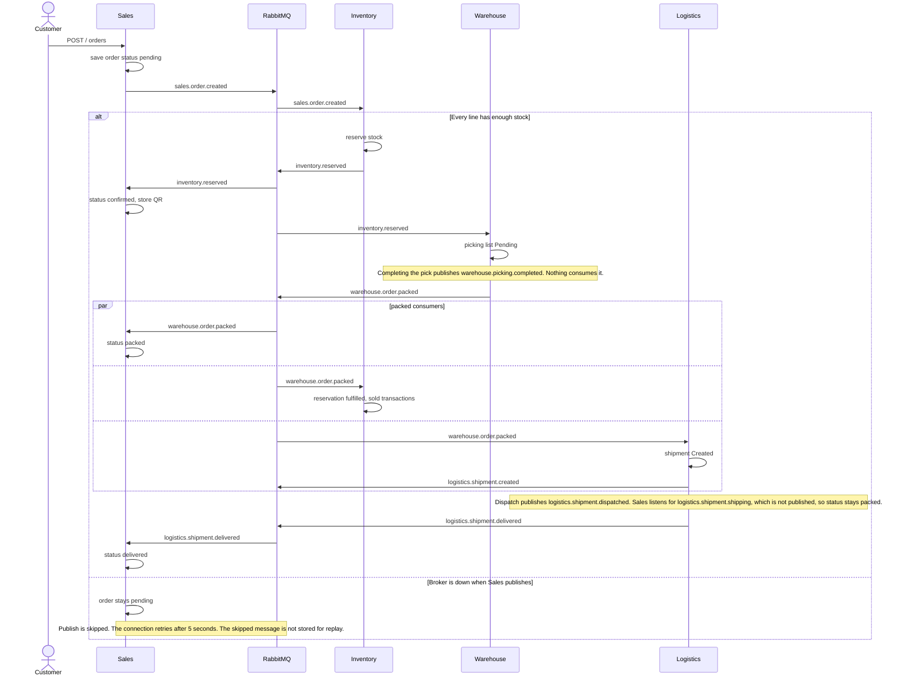

# Order lifecycle and event contracts

How an order moves from Sales through Inventory, Warehouse, and Logistics, and which RabbitMQ messages exist today.

Exchange: topic exchange `smartchain_exchange` (`RABBITMQ_EXCHANGE`). Each service uses a durable queue named `{RABBITMQ_QUEUE_PREFIX}{service}_events`. The prefix defaults to `smart-chain-`.

Payloads are JSON objects. None of them include a schema version field.

`LowStockPredicted` is not part of this order flow. It is documented at the end.

## Success path

A second stop, inside the consumer rather than at publish time: if any line has insufficient stock, Inventory logs the shortage and returns. It does not publish `inventory.reserved`. The `sales.order.created` delivery is still acknowledged, because the handler does not throw. The order remains `pending`.

Order status values in Sales are `pending`, `confirmed`, `packed`, `shipping`, `delivered`, and `cancelled`. The event path above sets `confirmed`, `packed`, and `delivered`. `shipping` is set only by a handler for `logistics.shipment.shipping`. No publisher uses that routing key. `PUT` order status can change the status in MongoDB without publishing an event.

## Acknowledgement and failure

All five consumers use manual acknowledgement (`noAck: false`) in their `subscribeToEvents` function:

| Outcome | What the consumer does |
|---|---|
| Handler promise resolves | `ack` |
| Handler promise rejects | `nack(msg, false, false)` — not requeued |
| Routing key has no handler on that queue | log, then `ack` |
| JSON parse throws | the consume callback throws before `ack` or `nack` |

Operational handlers catch their own errors and log them. A caught database error therefore resolves the promise and is acknowledged. It is not requeued.

`publishEvent` sends a JSON buffer with `channel.publish`. It does not set a persistence flag, message id, or publisher confirm. If `channel` is missing, the call logs a warning, returns `false`, and does not send the message. A closed connection schedules another connect after 5 seconds and, when handlers were already registered, subscribes again. That reconnect does not replay a publish that was skipped.

There is no dead-letter queue, retry exchange, or outbox.

## Operational catalog

Version is `none` for every row: the payload has no version field.

| Routing key | Producer | Consumer (queue) | Payload fields | Version |
|---|---|---|---|---|
| `sales.order.created` | Sales `publishOrderCreated` after `POST` create order | Inventory `handleOrderCreated` (`inventory_events`) | `orderId`, `customerId`, `items[]` of `{ productId, quantity, shippingAddress }` | none |
| `inventory.reserved` | Inventory `handleOrderCreated`, and `PUT /inventory/reserve` | Sales `handleInventoryReserved` (`sales_events`); Warehouse `handleInventoryReserved` (`warehouse_events`) | `orderId`, `reservationId`, `items` | none |
| `inventory.low_stock` | Inventory on create product, adjust, reserve, and `handleOrderCreated`, when `stockLevel <= reorderPoint` | none | `productId`, `currentLevel`, `reorderPoint` | none |
| `inventory.released` | Inventory `handleOrderCancelled` and `PUT /inventory/release` | none | `orderId`, `items` | none |
| `sales.order.cancelled` | none. Cancelling through the Sales status API updates MongoDB only | Inventory `handleOrderCancelled`; Warehouse `handleOrderCancelled` | handlers read `orderId` | none |
| `warehouse.picking.completed` | Warehouse when a picking list status is set to `Completed` | none | `pickingListId`, `orderId`, `pickedItems`, `completedBy` | none |
| `warehouse.order.packed` | Warehouse `POST /packages` | Sales `handleOrderPacked`; Inventory `handleOrderPacked`; Logistics `handleOrderPacked` | `orderId`, `packageId`, `qrCode`, `dimensions`, `shippingAddress` | none |
| `logistics.shipment.created` | Logistics `handleOrderPacked` after it saves the shipment | none | `shipmentId`, `orderId`, `packageId` | none |
| `logistics.shipemnt.created` | Logistics `POST /shipments`. The key is spelled this way in code | none | `shipmentId`, `orderId`, `packageId` | none |
| `logistics.shipment.dispatched` | Logistics dispatch, and status update when status is `Dispatched` | none | `shipmentId`, `orderId`, `dispatchDate`, `trackingNumber` | none |
| `logistics.shipment.shipping` | none | Sales `handleShipmentShipping` (`sales_events`) | handler reads `orderId` | none |
| `logistics.shipment.delivered` | Logistics deliver, and status update when status is `Delivered` | Sales `handleOrderDelivered` (`sales_events`) | `shipmentId`, `orderId`, `deliveryDate` | none |
| `TrackingUpdated` | Logistics `POST /tracking/:id/tracking-events` | none | `shipmentId`, `orderId`, `status`, `location` | none |

`items` on `inventory.reserved` is the `items` array from `sales.order.created`. Warehouse fills missing `sku`, `name`, `location`, and `shippingAddress` when it builds the picking list.

## Where the code lives

| Step | Path |
|---|---|
| Publish `sales.order.created` | `microservices/sales/controllers/events/eventHandlerController.js` (`publishOrderCreated`), called from `microservices/sales/controllers/orderController.js` |
| Sales bindings and handlers | `microservices/sales/app.js`, `microservices/sales/services/eventService.js` |
| Reserve, release, low stock, packed | `microservices/inventory/controllers/events/eventHandlerController.js`, `microservices/inventory/controllers/reservationController.js` |
| Inventory bindings | `microservices/inventory/app.js`, `microservices/inventory/services/eventService.js` |
| Picking list and `warehouse.picking.completed` | `microservices/warehouse/controllers/events/eventHandlerController.js`, `microservices/warehouse/controllers/pickingController.js` |
| `warehouse.order.packed` | `microservices/warehouse/controllers/packageController.js` |
| Shipment create, dispatch, deliver | `microservices/logistics/controllers/events/eventHandlerController.js`, `microservices/logistics/controllers/shipmentController.js`, `microservices/logistics/controllers/trackingController.js` |

The same ack rules are in each service `services/eventService.js`.

## Advisory event: LowStockPredicted

`LowStockPredicted` is separate from `inventory.low_stock` and from the order flow.

| | |
|---|---|
| Routing key | `analytics.low_stock.predicted` |
| When | `GET /reorder` in Analytics, for each active product where `predictedDemand > stockLevel` |
| Producer | `microservices/analytics/services/lowStockPredictedService.js` |
| Consumer | Analytics only, on `smart-chain-analytics_events`. The handler logs the message. It does not create a purchase order or change stock |
| Payload | `event` (`"LowStockPredicted"`), `productId`, `sku`, `name`, `stockLevel`, `predictedDemand`, `horizonDays`, `forecastMethod`, `reorderPoint`, `suggestedQuantity`, `emittedAt` |
| Version | none |

If RabbitMQ is not connected, reorder still returns JSON and the publish is skipped. Details of the forecast rule are in [analytics-technical-note.md](./analytics-technical-note.md).
